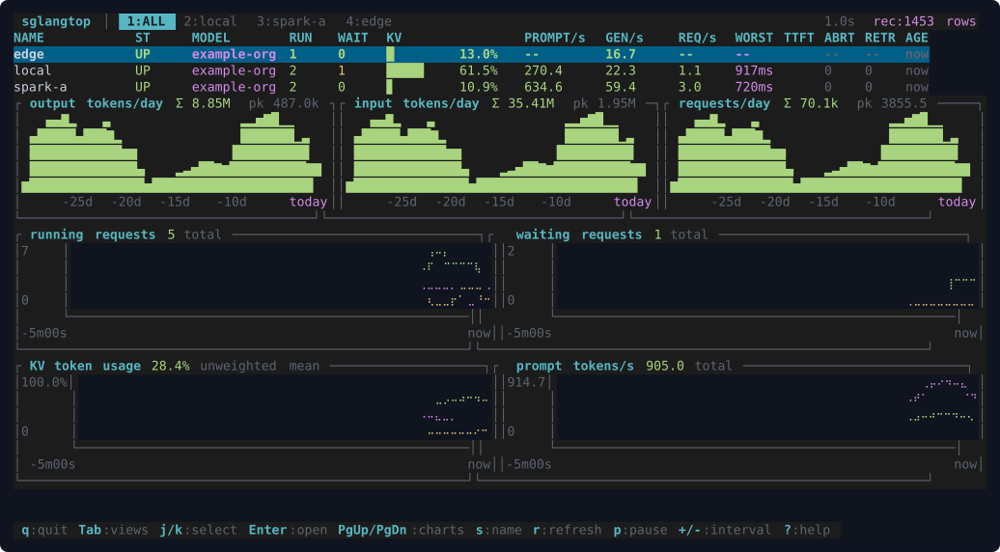
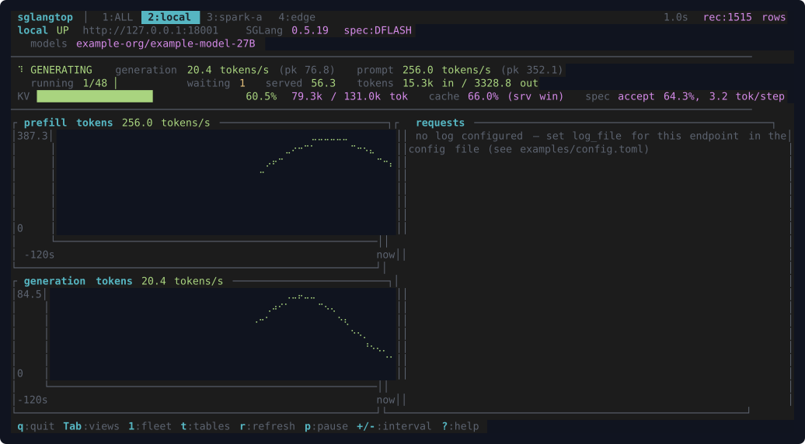

# sglangtop

A colorful, DGXTOP-style terminal dashboard for monitoring
[SGLang](https://docs.sglang.io/) servers — models, request activity,
throughput, latency percentiles, KV token usage, cache hit rate, and
speculative-decoding stats — for one local instance or a whole fleet, from a
single static binary.

```
sglangtop            # monitors http://127.0.0.1:30000
```

**Fleet overview** — endpoint table, past-30-days usage, rolling history:



**Endpoint detail** — pulse strip and token-rate charts (press `t` for
latency-percentile tables):



*(Screenshots captured against local mock SGLang servers; the `edge`
endpoint runs without `--enable-metrics` to show the `/v1/loads` fallback.)*

## What it is

- **Read-only, and it means it**: polls `/metrics`, plus `/ping`,
  `/server_info`, `/v1/models`, and `/v1/loads`, with GET requests only.
  Never proxies, inspects, or modifies inference traffic; never controls the
  server. In particular it never calls `/health` or `/health_generate`:
  upstream they share one handler, and with
  `SGLANG_ENABLE_HEALTH_ENDPOINT_GENERATION` set `/health` runs a real
  one-token generation, so polling it at cadence would make the monitor
  itself a permanent ~1 token/s of load on an idle server. `/ping` is an
  unconditional 200 and costs nothing.
- **Works even without `--enable-metrics`**: full dashboards need the
  server's Prometheus metrics, but when `/metrics` is 404 sglangtop
  automatically falls back to the always-on `/v1/loads` gauges — running and
  waiting requests, token usage, cache hit rate, speculative-decoding accept
  stats — and marks the endpoint `LOADS`. Rates, percentiles, and daily usage
  honestly show `--` until metrics are enabled.
- **Accelerator-agnostic**: works at the metrics layer — NVIDIA, AMD, CPU,
  any SGLang backend. No `nvidia-smi`, NVML, or vendor libraries.
- **Self-contained**: one static Linux binary. No Python, Docker,
  Prometheus, Grafana, or system OpenSSL. TLS via rustls.
- **Version-tolerant**: capabilities are detected from what the endpoint
  exposes; renamed metrics map through an alias table; missing metrics show
  `--` (never a fake 0); unknown metrics are tolerated.
- **Honest numbers**: rates are reset-aware (server restarts show a
  `RESTARTED` badge, never negative rates), percentiles are labelled
  estimates, stale endpoints show `STALE`, server-computed estimates are
  marked `~`, and percentages are never averaged unless capacity-weighted.

**What it deliberately does not do**: per-user/conversation attribution,
host hardware monitoring, alerts/webhooks, web UI, OpenTelemetry, server
control, telemetry.

## Install

Requires stable Rust (1.88+): <https://rustup.rs>

```bash
git clone https://github.com/yongzane00/sglangtop && cd sglangtop
cargo build --release
./target/release/sglangtop --help
```

`cargo install --path .` also works. Binary releases (musl x86_64 +
aarch64, SHA-256-verified installer) are planned.

## Usage

```bash
sglangtop                                        # one local server
sglangtop -e local=http://127.0.0.1:30000 \
        -e spark-a=https://10.0.0.21:8443        # a named fleet
sglangtop -e dev=http://10.0.0.21:30000@64       # @64 overrides the n/max cap
sglangtop --refresh-interval-ms 2000             # slower refresh
sglangtop --no-record                            # disable usage recording
sglangtop --completions bash                     # shell completions
```

The running-requests `n/max` bar is automatic: sglangtop reads the server's
`--max-running-requests` from `/server_info`. The `@CAP` suffix (or
`max_running` in the config file) only overrides it.

Recording is on by default (`~/.local/share/sglangtop/usage.db`, 30-day
retention) and feeds the fleet's daily-usage charts; `--record PATH`
relocates it. Only aggregate metric samples are stored — never prompts,
tokens, or headers.

### Configuration file

`~/.config/sglangtop/config.toml` (or `--config PATH`); see
[examples/config.toml](examples/config.toml) for the annotated format.
Precedence: defaults < file < CLI flags. Secrets are environment-variable
*references* — never values in the file, never logged or displayed:

```toml
[[endpoints]]
name = "spark-a"
url  = "https://10.0.0.21:8443"
bearer_token_env = "SPARK_A_SGLANG_TOKEN"  # name of the variable, not the token
```

### Keys

| Key | Action |
| --- | --- |
| `q` / `Ctrl+C` | quit |
| `Tab` / `1`…`9` | switch views |
| `j`/`k`, `Enter` | select / open endpoint (fleet view) |
| `PgUp`/`PgDn`, wheel | scroll the history charts |
| `s` | cycle fleet sort column |
| `t` | endpoint view: charts ⇄ activity/latency tables |
| `r` | force refresh |
| `p` | pause display (collection continues) |
| `+` / `-` | faster / slower refresh |
| `?` | help |

### Server-side setup

Launch SGLang with `--enable-metrics` for the full experience:

```bash
python -m sglang.launch_server --model-path <model> --enable-metrics
```

Without it, sglangtop still shows live gauges via `/v1/loads` (badged
`LOADS`) and tells you what's missing. PD-disaggregated deployments are two
endpoints (prefill + decode), each badged with its role. Speculative
decoding, when active, adds accept-rate/accept-length stats and a chart.

## Compatibility

Current SGLang releases (`sglang:` metric names, ≥ 0.4.9 spellings) are the
primary target; one alias covers the pre-0.4.9 inter-token-latency rename.
Unrecognized metrics are parsed and skipped without breaking anything. The
exact curated-metric table: [docs/METRICS.md](docs/METRICS.md); the verified
upstream semantics it rests on: [docs/SGLANG-SEMANTICS.md](docs/SGLANG-SEMANTICS.md).

The `sgl-router`'s own `sgl_router_*` metrics are a different namespace and
are not curated (pointing sglangtop at a router shows `--`, not wrong data).

Works on 256-color and truecolor terminals; `NO_COLOR` / `--no-color`
gives a monochrome ASCII theme. Tuned for ~120×30, degrades gracefully
below.

## Development

```bash
cargo fmt --all -- --check
cargo clippy --all-targets --all-features -- -D warnings
cargo test --all-features
cargo build --release
```

Tests run against a real SGLang 0.5.19 `/metrics` capture
(`tests/fixtures/`), synthetic PD fixtures, and local httpmock servers —
never the network. See [CONTRIBUTING.md](CONTRIBUTING.md) and the
[documentation index](docs/README.md) — architecture, metric semantics,
and design deep-dives live under `docs/`.

## License

Licensed under either of

- Apache License, Version 2.0 ([LICENSE-APACHE](LICENSE-APACHE))
- MIT license ([LICENSE-MIT](LICENSE-MIT))

at your option.

Unless you explicitly state otherwise, any contribution intentionally
submitted for inclusion in the work by you, as defined in the Apache-2.0
license, shall be dual licensed as above, without any additional terms or
conditions.
